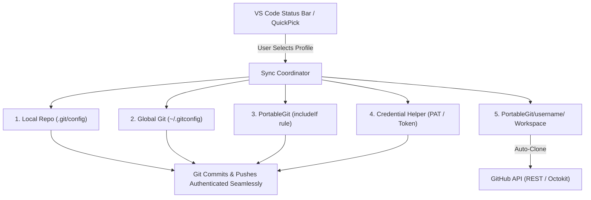

# Git Profile & PortableGit Workspace Switcher

[](https://marketplace.visualstudio.com)
[](https://www.typescriptlang.org/)
[](LICENSE)

A lightweight, powerful Visual Studio Code extension designed for developers juggling multiple GitHub accounts (Personal, Work, Client, or Open Source).

It dynamically synchronizes your **Git Commit Author (`user.name` & `user.email`)**, **GitHub Push Credentials (PAT / Credential Manager)**, and per-profile **`PortableGit/<username>` repository directories** with zero identity mismatch.

---

## The Problem It Solves

When switching between multiple Git/GitHub accounts on a single development machine:
* ⚠️ **Wrong Contributor Attribution:** Committing with a personal email on a company repository, or vice versa, polluting commit histories and contributor graphs.
* ⚠️ **Credential Manager Conflicts:** Windows Credential Manager or Git Credential Manager caches a single account token, causing `403 Permission Denied` when pushing to a repository owned by your other account.
* ⚠️ **Scattered Repositories:** Cloned repos end up mixed together on your local drive without clear per-account separation.

**`vscode-git-profile-switch` solves all three problems in one click.**

---

## Core Features

### 1. 🔄 Multi-Layer Atomic Identity Sync
Switching profiles instantaneously and safely updates all identity layers in parallel:
* **Local Workspace Config:** Updates `.git/config` (`user.name`, `user.email`, and authenticated `remote.origin.url`).
* **Global Git Config:** Updates global `~/.gitconfig` fallback.
* **PortableGit `includeIf` Rules:** Configures folder-level rules (`PortableGit/<username>/.gitconfig-profile`) ensuring any terminal or external Git tool running inside that folder automatically assumes the correct profile.
* **Credential Approval:** Feeds authenticated credentials to Git Credential Helper so pushes succeed immediately without interactive password prompts.
* **Real-Time Config Watcher:** Monitors `.git/config` and heals external overrides or mismatches automatically.

### 2. 📁 `PortableGit/<username>` Workspace Organization
Organizes your local code into clean, per-profile folder trees:
```text
PortableGit/
 ├── personal-dev/
 │    ├── portfolio-site/
 │    └── side-project/
 ├── acme-corp/
 │    ├── core-api/
 │    └── customer-dashboard/
 └── open-source-team/
      ├── project-alpha/
      └── project-beta/
```
* **Auto-Clone Missing Repositories:** Fetches public & private repos accessible by your GitHub Personal Access Token (PAT) and clones missing ones straight into `PortableGit/<username>/`.
* **Organize Existing Repositories:** Automatically detects standalone repos sitting in the root of `PortableGit/` and moves them into their corresponding user subfolders while preserving `.env`, `.venv`, and `node_modules`.

### 3. 🔐 Encrypted Token Storage & Full Profile Management
* **Zero Plaintext Secrets:** GitHub Personal Access Tokens (PATs) are stored in VS Code's encrypted `SecretStorage` (backed by Windows Credential Manager / macOS Keychain / Linux Secret Service).
* **Full CRUD Operations:** Add, edit, test, rotate tokens, and delete profiles directly within VS Code.
* **Interactive Status Bar Item:** Shows active profile label, GitHub username, and repository sync state at a glance.

### 4. 🧠 Smart Workspace Auto-Detection
* When you open a repository, the extension automatically detects the remote owner and switches your active profile to match the repository—avoiding accidental cross-account commits.

---

## Quick Start

### 1. Install the Extension
Install directly from the packaged `.vsix` file:
* Open VS Code.
* Press `Ctrl+Shift+P` (or `Cmd+Shift+P` on macOS) and type:  
  **`Extensions: Install from VSIX...`**
* Select `vscode-git-profile-switch-1.0.0.vsix`.

Alternatively via terminal:
```powershell
code --install-extension vscode-git-profile-switch-1.0.0.vsix
```

### 2. Create Your Profiles
1. Press `Ctrl+Shift+P` and choose:  
   **`Git Profile: Add New Profile (Create)`**
2. Enter profile details:
   * **Profile Label:** e.g., `Personal`, `Work`, `Open Source`
   * **GitHub Username:** e.g., `octocat` or `john-dev`
   * **Git Author Name:** e.g., `John Doe`
   * **Git Author Email:** e.g., `john.doe@example.com` or `12345678+john-dev@users.noreply.github.com`
   * **GitHub PAT:** Optional, recommended for private repo sync & push authentication (`repo` scope).

### 3. Switch Profiles
* Click the **Profile indicator** in the VS Code Status Bar (bottom left) or run:  
  **`Git Profile: Switch Profile & Sync Workspace`**
* Select your desired profile. All configs and folders sync in seconds.

---

## Extension Commands

| Command | Command Identifier | Description |
| :--- | :--- | :--- |
| **Switch Profile & Sync Workspace** | `gitProfileSwitch.switch` | Open QuickPick switcher to change active profile and sync configs |
| **Add New Profile** | `gitProfileSwitch.add` | Create a new Git profile with encrypted GitHub PAT |
| **Edit Profile** | `gitProfileSwitch.edit` | Update profile metadata, author name/email, or rotate PAT |
| **Delete Profile** | `gitProfileSwitch.delete` | Delete profile and remove its encrypted secret token |
| **Sync & Auto-Clone All GitHub Repos** | `gitProfileSwitch.syncRepos` | Fetch remote GitHub repos and clone missing ones to `PortableGit/<username>` |
| **Organize Existing Repos into Folders** | `gitProfileSwitch.organizeExisting` | Move root repositories into matching `PortableGit/<username>` folders |
| **Verify Active Identity & Token** | `gitProfileSwitch.verify` | Test and display current commit author, remote origin, and GitHub API auth |
| **Open Active Profile Folder** | `gitProfileSwitch.openProfileFolder` | Open `PortableGit/<username>` in VS Code Explorer |

---

## Configuration Settings

You can customize the extension via VS Code Settings (`Ctrl+,` -> search `Git Profile Switch`):

| Setting | Default | Description |
| :--- | :--- | :--- |
| `gitProfileSwitch.portableGitRoot` | `C:\PortableGit` | Path where per-user folders (`PortableGit/<username>/<repos>`) reside. |
| `gitProfileSwitch.autoCloneOnSwitch` | `true` | Automatically clone missing remote repositories when switching profiles. |
| `gitProfileSwitch.autoOpenProfileWorkspace` | `"prompt"` | Behavior when switching: `"prompt"`, `"always"`, or `"never"` open profile folder. |
| `gitProfileSwitch.autoDetectFromRepo` | `true` | Auto-detect and switch profile based on currently active repository remote owner. |

---

## Architecture



---

## Development & Building

To modify or build this extension locally:

```powershell
# 1. Clone the repository
git clone https://github.com/your-username/vscode-git-profile-switch.git
cd vscode-git-profile-switch

# 2. Install dependencies
npm install

# 3. Compile TypeScript
npm run compile

# 4. Package into VSIX
npm run package
```

* Press **`F5`** inside VS Code to launch the Extension Development Host for debugging.

---

## License

This project is licensed under the [MIT License](LICENSE).
